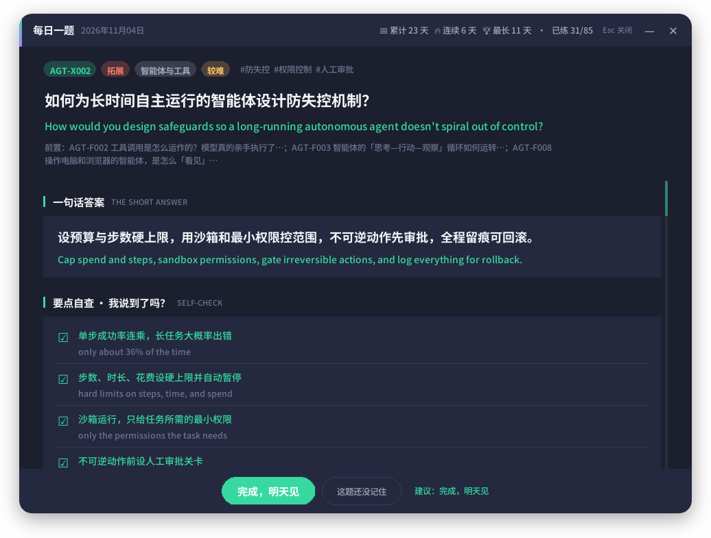
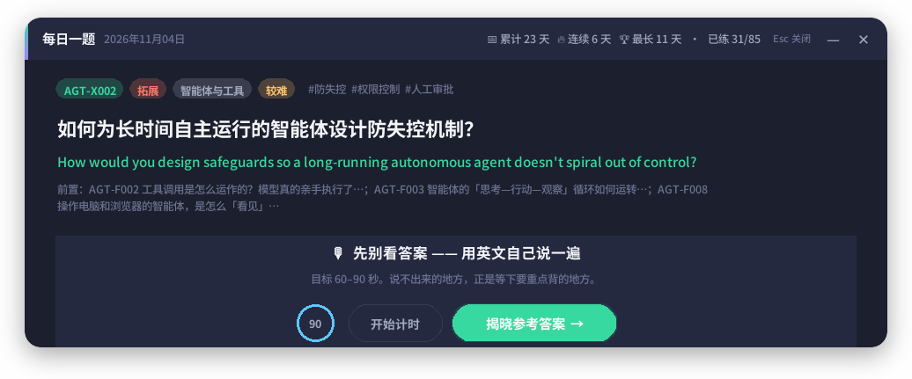
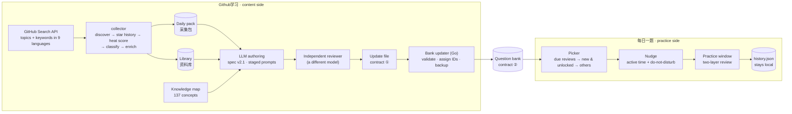
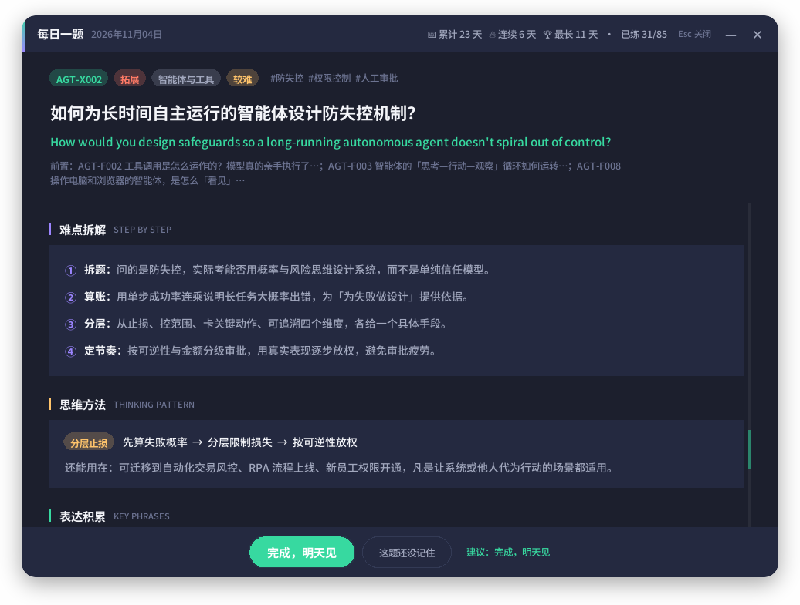

<div align="center">

# 每日一题 · AI PM Daily Drill

**A self-running learning system that turns trending GitHub projects into a prerequisite-aware question bank — and nudges you to practise one question a day, without ever interrupting an interview.**

[中文说明](README.zh-CN.md) · [Architecture](#architecture) · [Design decisions](#design-decisions) · [How it was built](docs/ai-collaboration.md)

[](https://github.com/MichaelZSH9898/ai-pm-daily-drill/actions/workflows/tests.yml)




</div>

---

## Why

I'm preparing for AI-era product management roles without a computer-science background. Three things kept going wrong with the usual "read articles, save bookmarks" approach:

1. **Trending projects are the wrong entry point.** A hot GitHub repo makes sense only after you know the five concepts it is built on. Advanced material read too early just doesn't stick.
2. **English is a second hurdle.** Understanding a concept is not the same as explaining it out loud in an English interview.
3. **Reminders that interrupt get disabled.** A pop-up during an online test or a video interview is worse than no reminder at all.

So I designed a small system that **collects, curates, sequences and delivers** — one question a day, in the right order, at a moment when I'm actually free.

## What it does

| | Component | What it does |
|---|---|---|
| 🛰 | **Collector** (`Github学习/collector`) | Every day, scans GitHub in **9 languages**, ranks projects by star growth relative to their own language community, classifies them into 19 AI directions, and writes a daily pack plus a long-term library. |
| 📚 | **Question bank** (`Github学习/当前题库`) | 85 bilingual questions across 7 domains (LLMs, prompting, RAG, agents, requirements, business architecture, information systems), built on a 137-concept knowledge map. Every question is either **F**oundation or e**X**tension, and every X question names its prerequisites. |
| 🧰 | **Bank updater** (`Github学习/工具源码/题库更新`, Go) | Validates an update file, assigns permanent IDs (never reused), checks the prerequisite graph for cycles and missing links, previews, backs up, then writes. |
| 🔔 | **Daily app** (`app.pyw`, `ui/`) | A background daemon that counts *active* computer time, stays silent during full-screen apps, presentations and microphone/camera use, then offers today's question. The answer screen is designed for self-checking first, deep explanation second. |

<table>
<tr>
<td width="38%"></td>
<td></td>
</tr>
<tr>
<td align="center"><sub>Nudge — appears only after real activity and outside do-not-disturb</sub></td>
<td align="center"><sub>Say it in English first (60–90 s timer), then reveal</sub></td>
</tr>
</table>

## Architecture



The two halves share **only a folder and two JSON contracts**. The practice app never reads the collector's state, and the collector never reads my learning history. Either side can be rewritten without touching the other.

## Design decisions

<details open>
<summary><b>1 · Prerequisite-aware curriculum (F / X levels)</b></summary>

- Every question is **F** (one concept: what it is, how it works) or **X** (trade-offs, methods, cases built on top).
- An X question must list at least one F question as a prerequisite. The app only pushes it after all prerequisites have been practised, so I never meet "context engineering for agents" before "what is a token".
- The bank updater rejects cycles, dangling prerequisites and deleting a question that others depend on.
- IDs such as `AGT-X002` are assigned by the tool and **never reused**, because learning history is keyed by ID.
</details>

<details>
<summary><b>2 · Multilingual discovery that doesn't drown in English</b></summary>

- A Chinese repo with 300 new stars may matter more in its community than an English one with 1,000. Heat is a **robust z-score within each language group** (median/MAD), not raw star counts.
- At least 30% of candidates are reserved for non-English projects; keyword searches run in Chinese, Japanese, Korean, Russian, Spanish, French, German and Portuguese.
- Document language is detected from the README (CJK by script, Latin/Cyrillic by a bundled model), not from the repo description.
- Of the 168 projects in the current library, 72 are documented in a language other than English.
</details>

<details>
<summary><b>3 · Respectful nudging</b></summary>

- The reminder counts **active** time (keyboard/mouse within the last 2 minutes), not wall-clock time.
- Do-not-disturb: Windows notification state (full-screen, presentation, focus assist), a foreground window covering the monitor (e.g. a browser-based online test), and **microphone or camera in use** (video interviews are often not full-screen).
- Snoozing resets a 1.5-hour active-time counter; "swap question" is allowed once a day and then turns into "skip today", to tell *the question doesn't appeal* apart from *I don't feel like it*.
- Reliability: an in-process watchdog dumps all thread stacks and restarts the daemon if the main loop stalls for 5 minutes; a scheduled task relaunches it if it crashes. This came from a real 8-day silent outage, found by reading the logs.
</details>

<details>
<summary><b>4 · Answer review designed for self-checking first</b></summary>

- **Layer 1 — check your answer (10 s):** a one-line answer, then 3–5 scoring points to tick ("did I say this?"). The tick count suggests *done* or *not yet*, but you make the final call.
- Model answer with **sentence-aligned Chinese** (toggle) and key phrases underlined in place (hover for meaning and usage).
- **Layer 2 — understand it:** basics for terms a beginner would trip on, the concept itself, a common misconception (*wrong → why → right*), a step-by-step walkthrough of the reasoning, a reusable thinking pattern, and phrases typed as vocabulary / collocation / sentence pattern.
- Layer 2 opens by default for X and hard questions, and stays folded for basics.

<p align="center"></p>
</details>

<details>
<summary><b>5 · An AI content pipeline with quality gates</b></summary>

- A written spec ([`题库编写规范.md`](Github学习/题库模板/题库编写规范.md)) defines every field, its depth by level, and good/bad examples, plus a fully worked example question.
- Authoring is **staged**: the model plans first (topics, prerequisites, the *key difficulty* of each question, 2–3 candidate angles and why one was chosen), a human approves, then it writes one domain per batch.
- Review is done by a **different model** in a fresh conversation, with an adversarial "find the single most damaging problem" step. Issues are classified as *fix the field* vs *go back to planning*.
- The Go updater checks what can be checked mechanically. It **blocks** imports that would break the UI (wrong types, empty fields, an answer that doesn't equal its aligned sentences joined) and **flags** softer issues (phrases not found verbatim, missing walkthroughs on X questions, temporary IDs leaking into text).
</details>

## By the numbers

| | |
|---|---|
| Questions | 85 (55 Foundation · 30 Extension), all bilingual, 7 domains |
| Knowledge map | 137 concept keys |
| Library | 168 projects, 72 non-English, refreshed daily |
| Tests | 23 (app) · 176 (collector, fully offline with fixtures) · 13 (Go updater) |
| Code | ~11k lines of Python and Go |

## Quick start

Requirements: Windows 10/11, Python 3.11+. Go 1.24 is only needed to rebuild the updater.

```powershell
git clone https://github.com/MichaelZSH9898/ai-pm-daily-drill.git
cd ai-pm-daily-drill

# Preview the nudge and the practice window right away
python app.pyw --test

# Install: auto-start at login + a watchdog task (no admin needed)
.\重装自启动.bat
```

Optional — run the collector (needs a GitHub token):

```powershell
cd Github学习\collector
python -m pip install -r requirements.txt
$env:GITHUB_TOKEN = "<your token>"
python collect.py --verbose          # daily run; skipped if it ran within 20 h
python collect.py --init --days 90   # one-off backfill to seed the library
```

Build the bank updater (or download `题库更新.exe` from Releases):

```powershell
cd Github学习\工具源码\题库更新
go test ./...
go build -ldflags "-s -w" -o ..\..\题库更新.exe .
```

Run the tests:

```powershell
python -m unittest discover -s tests
cd Github学习\collector; python -m unittest discover -s tests
```

## Repository layout

```
.
├── app.pyw                  # background daemon: active time, do-not-disturb, watchdog
├── practice.pyw             # open today's question directly
├── daily.py                 # CLI: browse, search, spaced repetition, Anki export
├── ui/                      # nudge popup, practice window, quiet-hours detection
├── tests/
├── 题库路径.json             # where the app reads the bank (the only link between halves)
├── Github学习/
│   ├── collector/           # GitHub collector (Python) + 176 offline tests
│   ├── 工具源码/题库更新/     # bank updater (Go)
│   ├── 当前题库/             # the question bank — contract ②
│   ├── 题库模板/             # spec v2.1, update template, authoring & review prompts
│   ├── 知识地图.json         # concept keys referenced by questions
│   ├── 资料库/               # library index (third-party READMEs are not redistributed)
│   ├── 素材库/               # curated notes for general PM topics
│   ├── 开发记录/             # decision records, review and self-check reports
│   └── AI实践采集与题库生成_方案设计.md   # full design spec (M0–M6)
├── examples/                # an abridged real daily pack
└── docs/                    # screenshots, how it was built
```

Folder names are kept in Chinese on purpose: the scripts and specs reference them, and the product is Chinese-first.

## How it was built

I built this as the product owner, working with AI coding agents (Claude, Haiku, Gemini). I wrote the requirements, made the scope and design calls, and set up review loops, with one model writing and another reviewing. The full story, including what went wrong and what I'd do differently, is in **[docs/ai-collaboration.md](docs/ai-collaboration.md)**.

## Related projects

- **浑天图谱 · Armillary** — a 3D map of the open-source "foundations" AI apps stand on, built from the same collected data (in progress).
- **[大水理论督察员 · Big Water Inspector](https://github.com/MichaelZSH9898/Big-water-inspector)** — a hydration reminder that reuses this project's do-not-disturb logic.

## License

[MIT](LICENSE). Project names and descriptions in the library index belong to their respective owners.
