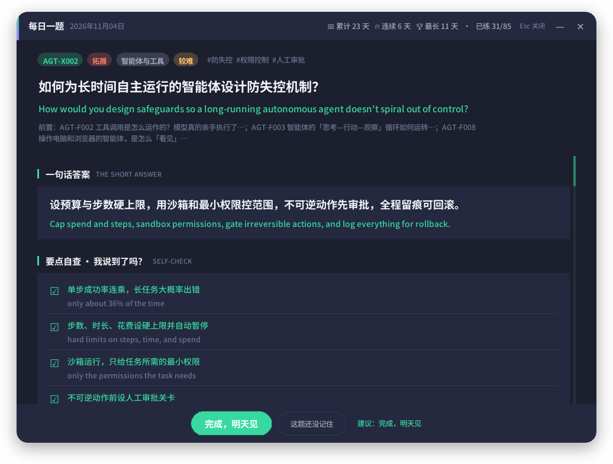
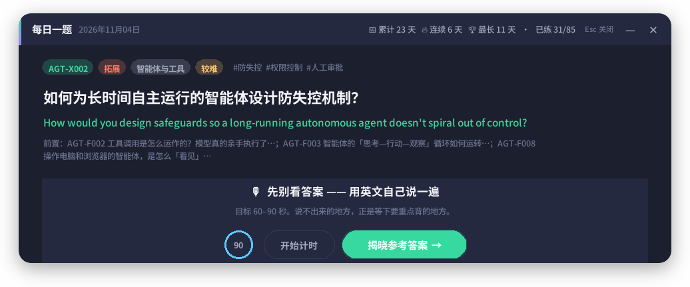
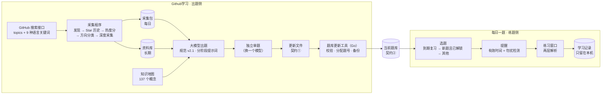
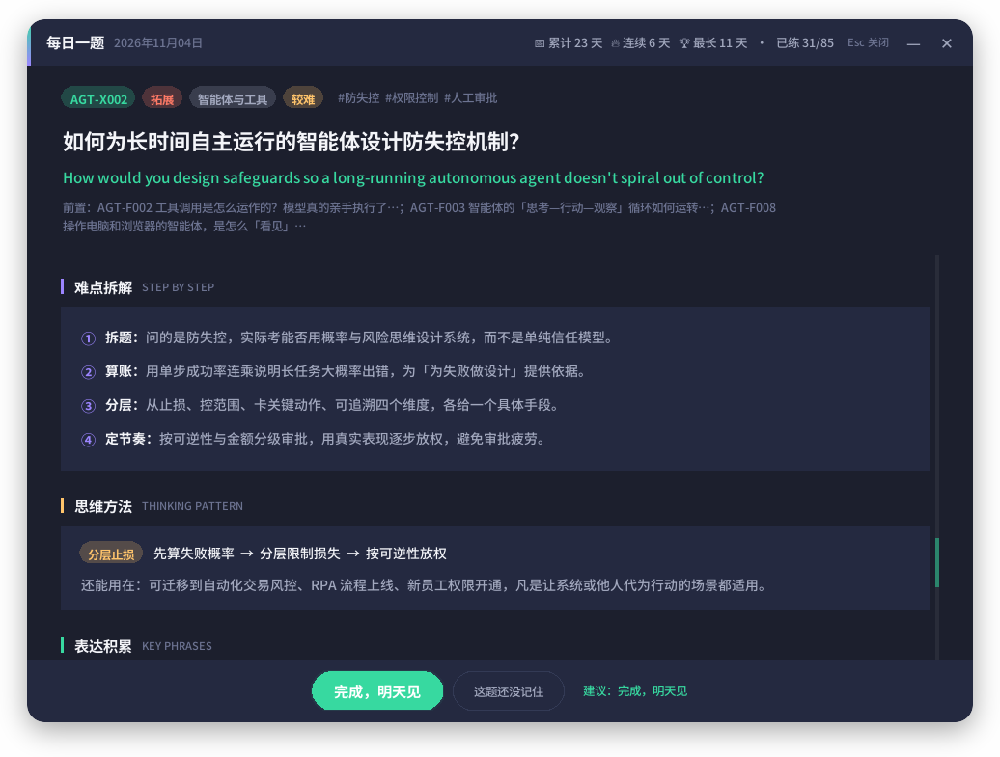

<div align="center">

# 每日一题 · AI PM Daily Drill

**一套自己运转的学习系统：把 GitHub 上的热门项目整理成「先学基础、再学拓展」的分层题库，每天在你真正有空的时候递上一道题，绝不在笔试或面试时打扰你。**

[English](README.md) · [架构](#架构) · [设计决策](#设计决策) · [开发过程](docs/ai-collaboration.md#中文)



</div>

---

## 为什么做

我在准备 AI 时代的产品经理岗位，但没有计算机科班背景。常规的「看文章、存收藏」方式反复在三个地方失效：

1. **热门项目不是入口。** 一个火爆的 GitHub 仓库，只有先懂它底下的五个概念才看得懂。拓展内容学得太早，根本记不住。
2. **英语是第二道坎。** 懂了一个概念，不等于能在英文面试里把它讲出来。
3. **会打扰人的提醒最后都会被关掉。** 在线笔试或视频面试时弹出来的提醒，比没有提醒还糟糕。

所以我设计了一套小系统，负责**采集、整理、排序、递送**：每天一道题，顺序正确，出现在我真正空闲的时候。

## 它做什么

| | 组件 | 作用 |
|---|---|---|
| 🛰 | **采集程序**（`Github学习/collector`） | 每天用 **9 种语言**扫描 GitHub，按项目在**本语言社区内**的 Star 增长排序，归入 19 个 AI 方向，产出当日采集包并沉淀进长期资料库 |
| 📚 | **题库**（`Github学习/当前题库`） | 85 道中英双语题，覆盖 7 个领域：大模型原理、提示与上下文工程、检索增强、智能体、需求分析、业务架构、信息系统；建立在 137 个概念键的知识地图上。每道题分为**基础 F** 或**拓展 X**，拓展题必须写明前置题 |
| 🧰 | **题库更新工具**（`Github学习/工具源码/题库更新`，Go） | 校验更新文件，分配永不复用的正式题号，检查前置关系有没有成环或缺失，预览、备份后写入 |
| 🔔 | **每日一题**（`app.pyw`、`ui/`） | 后台守护进程：累计**有效**使用电脑的时间，遇到全屏程序、演示模式、麦克风或摄像头正在使用时保持安静，然后递上今天的题。解析页先帮你核对，再帮你弄懂 |

<table>
<tr>
<td width="38%"></td>
<td></td>
</tr>
<tr>
<td align="center"><sub>提醒：只在真实使用电脑、且不在勿扰状态时出现</sub></td>
<td align="center"><sub>先用英文自己说一遍（60–90 秒计时），再揭晓答案</sub></td>
</tr>
</table>

## 架构



两侧**只通过一个文件夹和两种 JSON 格式相连**。练题程序不读采集程序的状态，采集程序也不读我的学习记录。任何一侧都可以重写，不影响另一侧。

## 设计决策

<details open>
<summary><b>1 · 分层题库：基础 F / 拓展 X</b></summary>

- 每道题要么是 **F**（一个概念本身：是什么、怎么运作），要么是 **X**（建立在基础之上的取舍、方法、案例）。
- 拓展题至少要有一道基础题作前置。程序只在前置题全部练过之后才推送它，所以我不会在搞懂「什么是 Token」之前先碰到「智能体的上下文工程」。
- 更新工具会拦下前置成环、引用不存在的前置，以及删除被其他题依赖的题。
- `AGT-X002` 这样的题号由工具分配、**永不复用**，因为学习记录是按题号记的。
</details>

<details>
<summary><b>2 · 不被英文淹没的多语言发现</b></summary>

- 一个中文仓库新增 300 Star，在它的社区里可能比英文仓库新增 1000 Star 更有分量。热度分是**语言组内的稳健 z 分数**（中位数 / 绝对中位差），而不是原始 Star 数。
- 候选中至少 30% 留给非英语项目；关键词搜索覆盖中、日、韩、俄、西、法、德、葡语。
- 文档语言根据 README 判断（中日韩按文字系统，拉丁与西里尔文本用随包附带的小模型），而不是看仓库描述。
- 当前资料库 168 个项目中，有 72 个的文档不是英文。
</details>

<details>
<summary><b>3 · 不打扰人的提醒</b></summary>

- 提醒累计的是**有效**时间（2 分钟内动过键鼠），不是挂钟时间。
- 勿扰检测：Windows 通知状态（全屏、演示、专注助手）、铺满屏幕的前台窗口（例如浏览器里的在线笔试），以及**麦克风或摄像头正在使用**（视频面试往往不是全屏）。
- 「稍后再说」重新累计 1.5 小时有效时间；「随机换题」每天一次，换过之后按钮变成「算了，今天休息」，以此区分「题目不吸引我」和「我今天不想学」。
- 可靠性：主循环卡住 5 分钟，程序内的看门狗会记下各线程的现场并自动重启；进程崩溃时，定时任务会把它拉起来。这一条来自一次真实的 8 天静默停机，是读日志查出来的。
</details>

<details>
<summary><b>4 · 先核对、后讲透的解析页</b></summary>

- **第一层 · 对答案（10 秒）**：一句话答案，加上 3–5 个可勾选的采分要点（「我说到了吗」）。勾选数会给出「完成」或「还没记住」的建议，最终由你自己决定。
- 参考答案配**逐句中文对照**（可开关），关键表达直接在原文里划线，悬停显示意思和用法。
- **第二层 · 弄懂它**：初学者会卡住的基础术语、本题概念解析、常见误区（错在哪 → 为什么 → 怎样判断）、思考过程的逐步拆解、可迁移的思维方法，以及按词汇 / 搭配 / 句型分类的表达积累。
- 拓展题和较难题默认展开第二层，基础题默认折叠。

<p align="center"></p>
</details>

<details>
<summary><b>5 · 带质量关卡的 AI 出题流水线</b></summary>

- 一份书面规范（[`题库编写规范.md`](Github学习/题库模板/题库编写规范.md)）定义了每个字段、按层级应写多深、好坏例子，并附一道完整的示范题。
- 出题**分阶段**：模型先做规划（题目、前置关系、每道题的「关键难点」、2–3 个答题角度以及取舍理由），人审批后，再一次写一个领域。
- 审题交给**另一个模型**、在新对话里进行，并有「找出最致命的一个问题」的对抗环节；问题分成「改字段」和「回到规划」两类。
- Go 工具负责机械检查：会让界面错乱的问题（类型不对、内容为空、答案与逐句对照拼不上）直接拦下导入；较轻的问题（摘录在原文中找不到、拓展题缺难点拆解、正文里残留临时编号）给出提醒。
</details>

## 数字一览

| | |
|---|---|
| 题目 | 85 道（基础 55 · 拓展 30），全部中英双语，7 个领域 |
| 知识地图 | 137 个概念键 |
| 资料库 | 168 个项目，其中 72 个非英文，每日更新 |
| 测试 | 每日一题 23 条 · 采集程序 176 条（全部离线夹具）· 题库更新工具 13 条 |
| 代码 | 约 1.1 万行 Python 与 Go |

## 快速开始

环境：Windows 10/11，Python 3.11+。只有重新编译更新工具时才需要 Go 1.24。

```powershell
git clone https://github.com/MichaelZSH9898/ai-pm-daily-drill.git
cd ai-pm-daily-drill

# 立刻预览提醒弹窗和练习窗口
python app.pyw --test

# 安装：登录时自启动 + 守护定时任务（不需要管理员）
.\重装自启动.bat
```

可选：运行采集程序（需要 GitHub Token）：

```powershell
cd Github学习\collector
python -m pip install -r requirements.txt
$env:GITHUB_TOKEN = "<你的 Token>"
python collect.py --verbose          # 日常巡检；20 小时内运行过会自动跳过
python collect.py --init --days 90   # 一次性回溯，初始化资料库
```

编译题库更新工具（或在 Releases 下载 `题库更新.exe`）：

```powershell
cd Github学习\工具源码\题库更新
go test ./...
go build -ldflags "-s -w" -o ..\..\题库更新.exe .
```

运行测试：

```powershell
python -m unittest discover -s tests
cd Github学习\collector; python -m unittest discover -s tests
```

## 目录结构

```
.
├── app.pyw                  # 后台守护：有效时间、勿扰检测、看门狗
├── practice.pyw             # 直接打开今天的题
├── daily.py                 # 命令行：浏览、搜索、间隔复习、导出 Anki
├── ui/                      # 提醒弹窗、练习窗口、勿扰检测
├── tests/
├── 题库路径.json             # 每日一题从哪里读题库（两侧唯一的连接点）
├── Github学习/
│   ├── collector/           # GitHub 采集程序（Python）+ 176 条离线测试
│   ├── 工具源码/题库更新/     # 题库更新工具（Go）
│   ├── 当前题库/             # 题库本体：契约②
│   ├── 题库模板/             # 规范 v2.1、更新模板、出题与审题提示词
│   ├── 知识地图.json         # 题目引用的概念键
│   ├── 资料库/               # 资料库索引（不分发第三方 README 全文）
│   ├── 素材库/               # 通用产品领域的整理笔记
│   ├── 开发记录/             # 决策记录、审阅与自检报告
│   └── AI实践采集与题库生成_方案设计.md   # 完整设计方案（M0–M6）
├── examples/                # 一份真实采集包的节选
└── docs/                    # 截图、开发过程
```

目录名有意保留中文：脚本和规范都引用这些名字，产品本身也是中文优先。

## 开发过程

这个项目由我作为产品负责人，和多个 AI 编程助手（Claude、Haiku、Gemini）协作完成。需求、范围与设计取舍由我拍板，我还搭了「一个模型写、另一个模型审」的复核流程。完整过程，包括走过的弯路和复盘，见 **[docs/ai-collaboration.md](docs/ai-collaboration.md#中文)**。

## 相关项目

- **浑天图谱 · Armillary**：用同一批采集数据画出 AI 应用所依赖的开源「地基」3D 星图（开发中）。
- **[大水理论督察员 · Big Water Inspector](https://github.com/MichaelZSH9898/Big-water-inspector)**：复用本项目勿扰逻辑的喝水提醒。

## 许可证

[MIT](LICENSE)。资料库索引中的项目名称与描述归各自作者所有。
